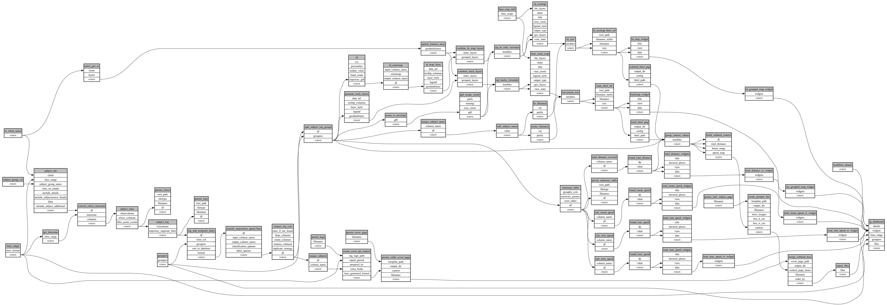

```
# AUTOGENERATED BY ECOSCOPE-WORKFLOWS; see fingerprint in README.md for details

```

```yaml
# fingerprint:
artifacts_sha256_basic: b88f7973550e94971039c93b327eef25feddafed6b0bf003144bc4006fd97f86
artifacts_sha256_strict: 3c27df47f5676e93d176b0bb6ac2b000721d3010218a398f74e4e552a7a4574b
installed_requirements:
- channel: https://repo.prefix.dev/ecoscope-workflows/
  name: ecoscope-platform
  version: {version: ==2.28.0}
- channel: https://repo.prefix.dev/ecoscope-workflows-custom/
  name: ecoscope-workflows-ext-custom
  version: {version: ==0.1.4}
- channel: https://repo.prefix.dev/ecoscope-workflows-custom/
  name: ecoscope-workflows-ext-ste
  version: {version: ==0.0.28}
- channel: https://repo.prefix.dev/ecoscope-workflows-custom/
  name: ecoscope-workflows-ext-lion-guardians
  version: {version: ==0.0.9}
- channel: conda-forge
  name: pydeck
  version: {version: ==0.9.2}
- channel: conda-forge
  name: opentelemetry-sdk
  version: {version: ==1.45.2}
params_sha256: 86f88a818b39521b3633a2395a9b7f1fa557115d4d41f3ea5d52b3f6f40418c3
spec_sha256: 38b3bd09b41171825dd571eafaad9ee8e2fe74e6b58ce6bcc09513f7d9de2257

```

# ecoscope-workflows-collared-report-workflow


