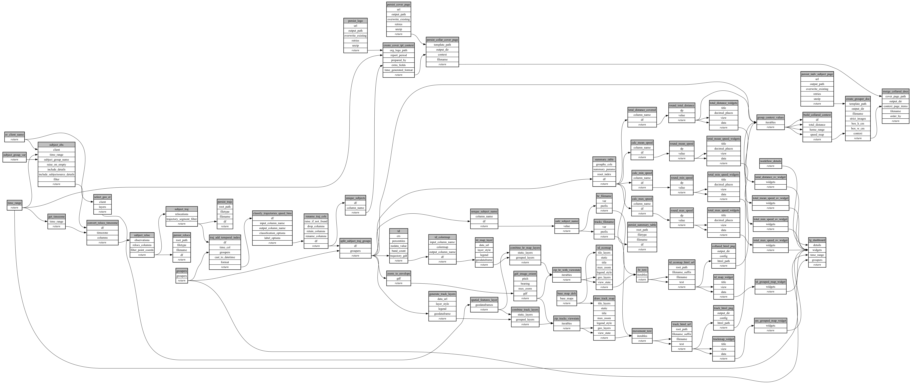

```
# AUTOGENERATED BY ECOSCOPE-WORKFLOWS; see fingerprint in README.md for details

```

```yaml
# fingerprint:
artifacts_sha256_basic: 384bfd08e8714c61cb3c0f5293090e317d4b03cfa523e8657b2b198576707047
artifacts_sha256_strict: 4d4eac72b60cae5cb6e15950e62022f6dba879e2ff7a5a4ea790b05c7fedde75
installed_requirements:
- channel: https://repo.prefix.dev/ecoscope-workflows/
  name: ecoscope-platform
  version: {version: ==2.26.0}
- channel: https://repo.prefix.dev/ecoscope-workflows-custom/
  name: ecoscope-workflows-ext-custom
  version: {version: ==0.1.4}
- channel: https://repo.prefix.dev/ecoscope-workflows-custom/
  name: ecoscope-workflows-ext-ste
  version: {version: ==0.0.28}
- channel: https://repo.prefix.dev/ecoscope-workflows-custom/
  name: ecoscope-workflows-ext-lion-guardians
  version: {version: ==0.0.9}
- channel: conda-forge
  name: pydeck
  version: {version: ==0.9.2}
- channel: conda-forge
  name: opentelemetry-sdk
  version: {version: ==1.45.1}
params_sha256: 56b00b20f5dc27763cf00619400cbff34e2755c5214525e3b7949e89d0d01f91
spec_sha256: c5b74bfa422a9e4e59c7481a363f964f825a900c0ecd99ced021f87f774f09eb

```

# ecoscope-workflows-collared-report-workflow


